# September 26: MCU and power skeleton

## What I did:

- Created the KiCad project and the root sheet.
- Placed the STM32H743XIH6 with decoupling and the USB-C power input.
- Added the four TLV757 LDOs for 3.3 V, 2.5 V, 1.8 V, and 1.2 V.
- Split the design into MCU, power, and USB sheets.

## Why:

- The MCU and all four rails have to exist before anything else can be wired.
- One sheet for the H743 would be unreadable, so the design is split by function.
- Rev A only uses USB-C for power, not for data.

## Screenshots:

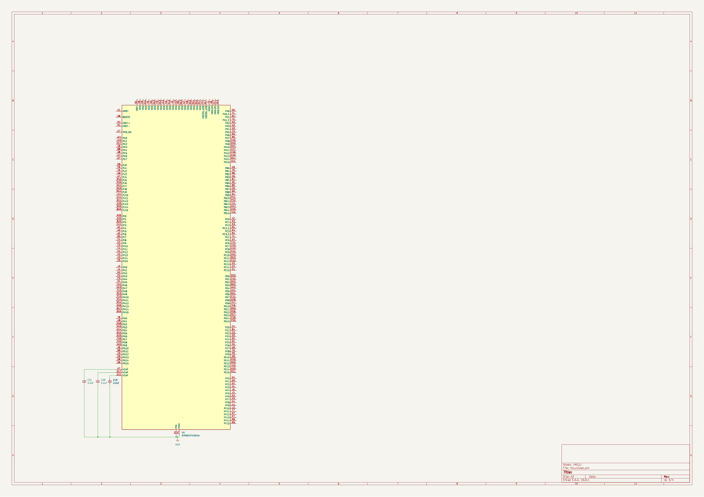

**Total time spent: 1 hour**

# September 27: Ethernet PHY

## What I did:

- Added the LAN8742A 10/100 PHY, the 25 MHz crystal, and the RJ45 with integrated magnetics.
- Added the RMII series resistors, PHY straps, and decoupling.
- Linked the Ethernet sheet into the root schematic.

## Why:

- The H743 has an RMII MAC, so the board should have an Ethernet port.
- The LAN8742A is a small RMII PHY and only needs a few external parts.
- The integrated magnetics save board area compared with a separate magnetics block.

## Screenshots:

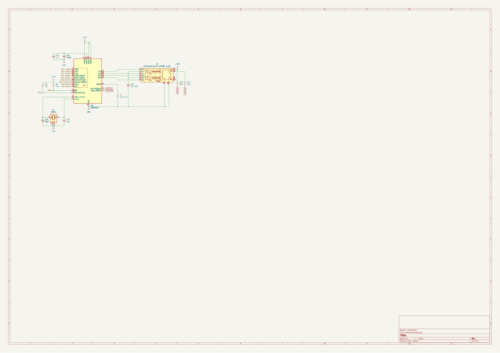

**Total time spent: 3.5 hours**

# September 28: Audio DAC, microSD, first outline

## What I did:

- Started the audio sheet with a stereo I2S DAC and the microSD socket on 4-bit SDMMC.
- Added the card-detect resistor and local decoupling.
- Created the PCB file and drew the first board outline.

## Why:

- Audio output and removable storage are the two main peripherals for the H743.
- A board outline early kept the schematic from growing past a realistic size.
- The first DAC choice was the CS43131, which I changed later.

## Screenshots:

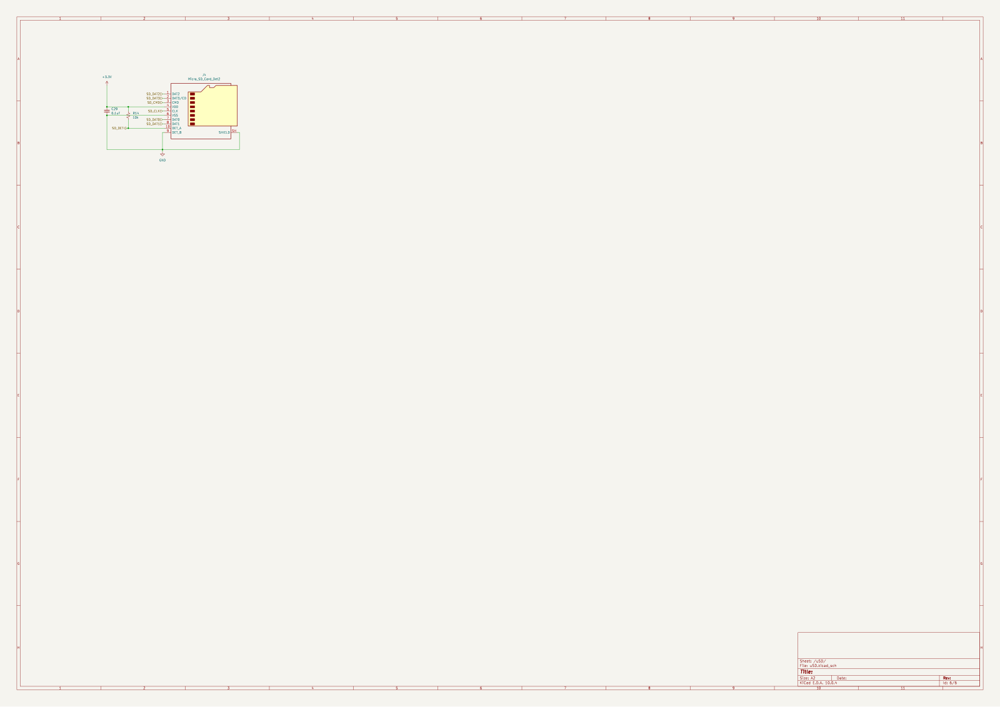

**Total time spent: 2 hours**

# September 29: USB High-Speed and PDM mic

## What I did:

- Added the USB3300 ULPI PHY, its 24 MHz crystal, and the USB-A host port with a power switch and ESD.
- Added the first PDM microphone to the audio sheet.
- Connected the ULPI and audio sheets to the root.

## Why:

- The H743 USB core needs an external High-Speed PHY.
- The board needs one USB-C port for power and one USB-A host port for devices.
- PDM mics use fewer pins than I2S mics and only need a clock and data line.

## Screenshots:

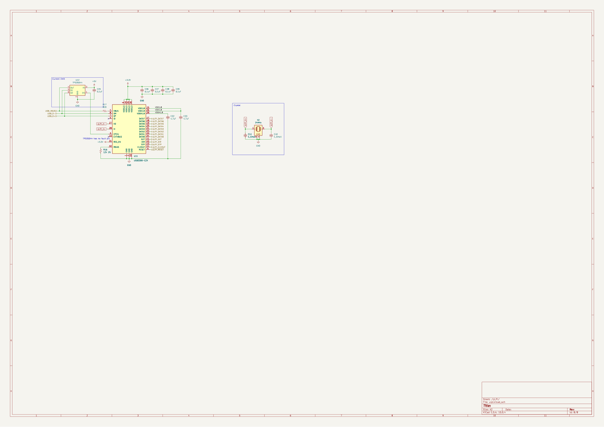

**Total time spent: 2.5 hours**

# September 30: FPGA and power filtering

## What I did:

- Added the iCE40 UP5K FPGA with its decoupling and ferrite-filtered 3.3 V, 2.5 V, 1.8 V, and 1.2 V rails.
- Added the 2x5 FPGA header and a second STM32H743 symbol unit for the remaining pins.
- Changed the DAC from the CS43131 to the CS4344.
- Fixed the USB host power switch from the TPD3S044 to the TPD3S014.

## Why:

- The FPGA is the main reason I built the board, so it needs its own rails and a header for experiments.
- The H743 has more pins than one symbol unit, so the second unit keeps the MCU sheet manageable.
- The CS4344 only needs I2S and has no I2C configuration, which makes bring-up simpler.
- The first USB switch part was wrong for a host port, so I corrected it before layout.

## Screenshots:

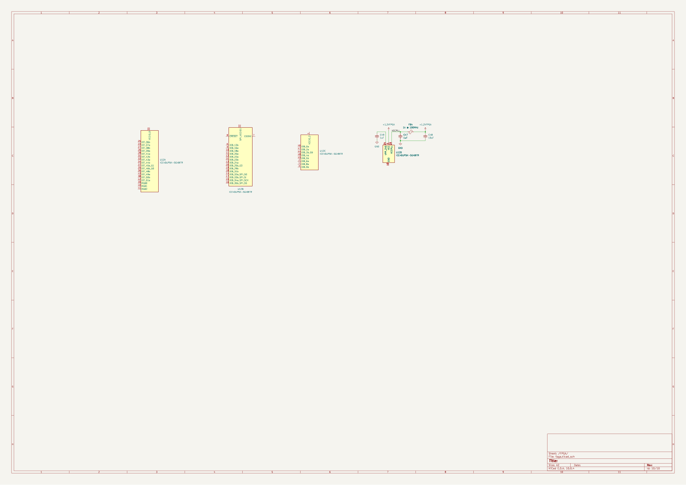

**Total time spent: 6.5 hours**

# October 1: MCU crystals

## What I did:

- Added the 25 MHz HSE crystal and the 32.768 kHz LSE crystal with load caps.
- Added six 1 uF caps on the power sheet.

## Why:

- The H743 needs an HSE for the 400 MHz clock tree and an LSE for the RTC.
- The LDO outputs only had bulk caps in the first pass.

## Screenshots:

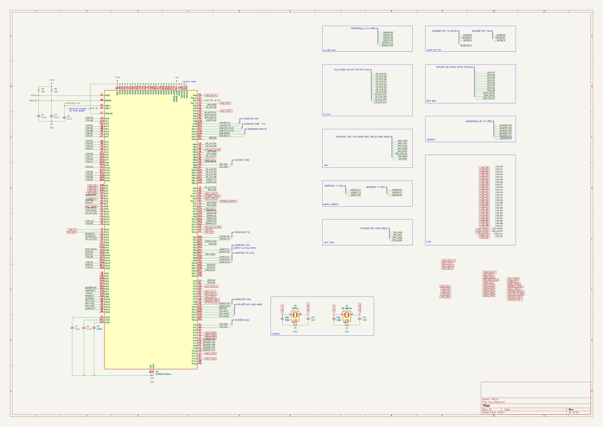

**Total time spent: 1.5 hours**

# October 2: Re-annotation and clock cleanup

## What I did:

- Re-annotated the schematic and fixed duplicate reference numbers.
- Tried a 12 MHz oscillator on the FPGA sheet, then removed it.
- Cleaned up crystal load caps and renumbered passives on the audio, Ethernet, and power sheets.

## Why:

- I re-annotated before layout so the BOM and PCB would match.
- The FPGA clock will come from the Si5351 instead of a dedicated oscillator.
- I had copied the first crystal values between sheets, and they needed to match each part.

## Screenshots:

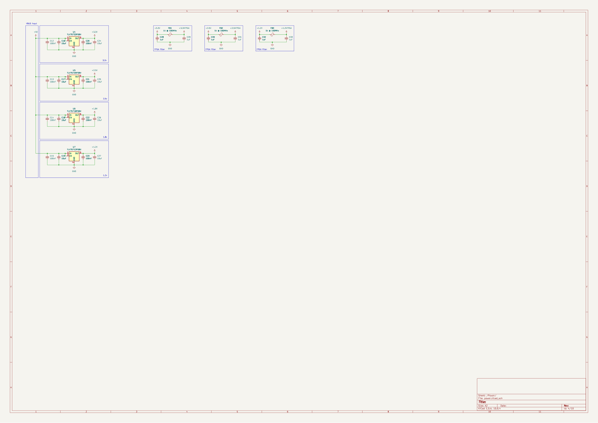

**Total time spent: 4.5 hours**

# October 3: LTDC placeholder

## What I did:

- Created the LTDC sheet with the display bus labels.
- Added a test point on the MCU sheet.

## Why:

- Reserving the LTDC pins now kept them out of the GPIO map.
- No display connector is chosen yet, so the sheet has labels only.

## Screenshots:

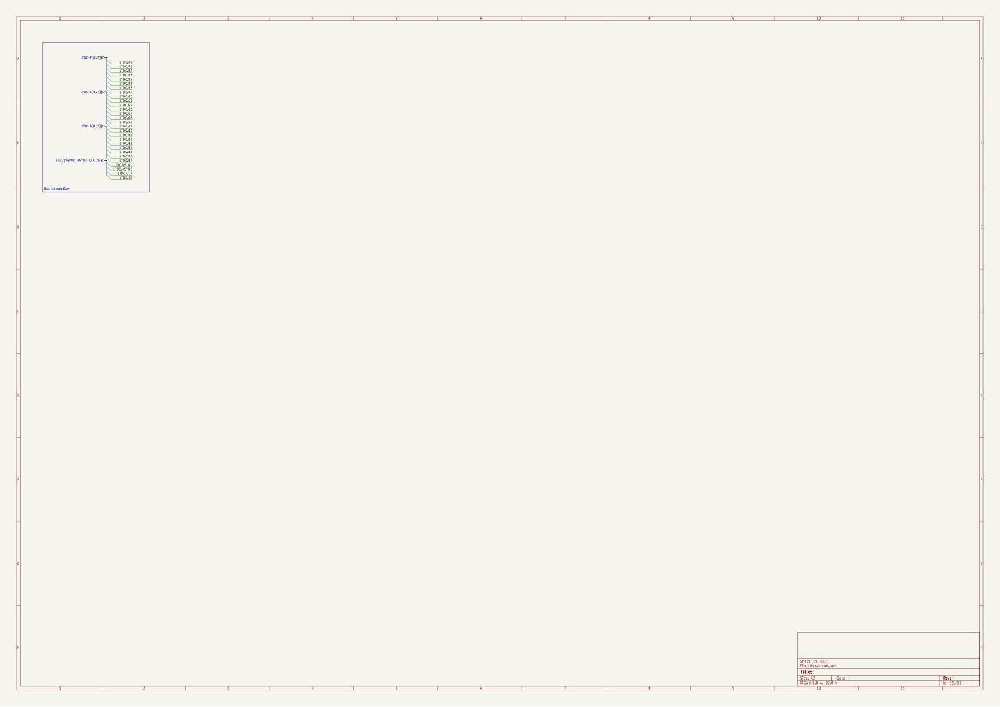

**Total time spent: 0.5 hours**

# October 4: Clock generator and audio jack

## What I did:

- Added the Si5351C clock generator, the 25 MHz TCXO, and eight 0 ohm series resistors on its outputs.
- Moved the 24 MHz ULPI clock and the FPGA clock experiments into the clock sheet.
- Added the 3.5 mm audio jack.

## Why:

- One clock generator can replace several oscillators and lets me change frequencies in firmware.
- The 0 ohm resistors let me disconnect or rework a clock output without cutting traces.
- The audio jack belongs on the audio sheet even though the clock sheet was the new work.

## Screenshots:

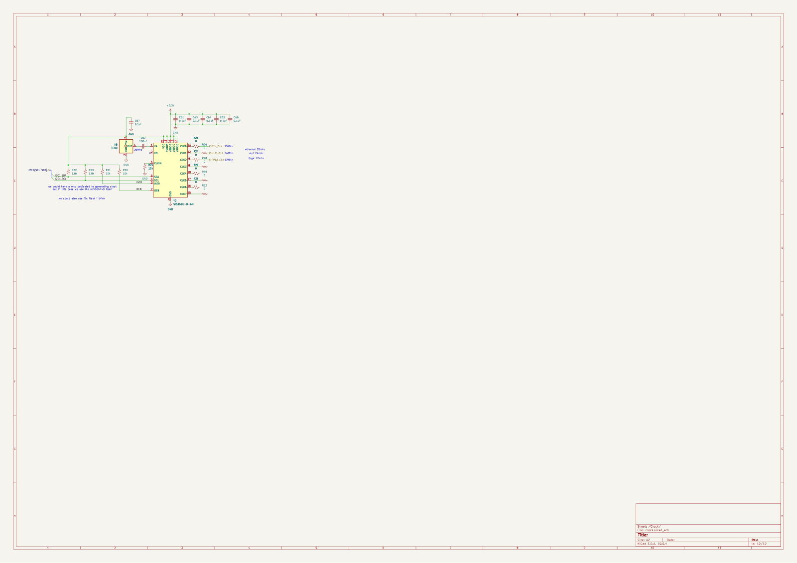

**Total time spent: 1.5 hours**

# October 5: First placement and routing

## What I did:

- Cleaned up the sheet references after moving parts between the audio, clock, FPGA, MCU, and microSD sheets.
- Placed the first 126 footprints on the board outline.
- Added the first 154 tracks, 115 vias, and copper zones.

## Why:

- I needed to get the board out of the schematic phase to check the outline.
- Started with the power and decoupling nets because they touch the most pins.
- Placed the connectors and large parts first to leave room for routing.

## Screenshots:

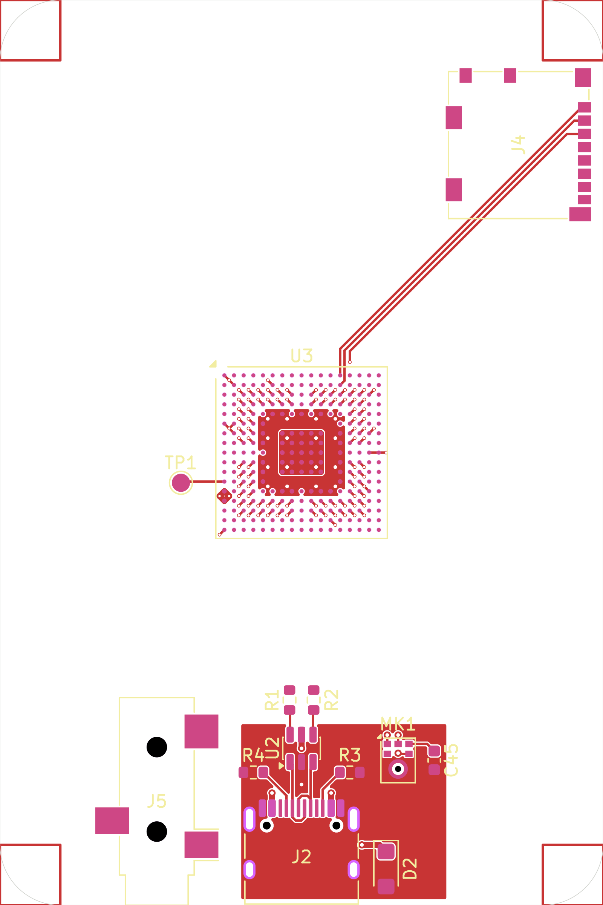

**Total time spent: 1 hour**

# October 6: ADV7513 library part

## What I did:

- Added the ADV7513BSWZ symbol, footprint, and STEP model to the local parts library.
- Put the new files in `parts/ADV7513BSWZ/`.

## Why:

- A local copy of the symbol and footprint keeps the part independent of an external library.
- The footprint needed to match the QFP-64 package in the datasheet.

## Screenshots:

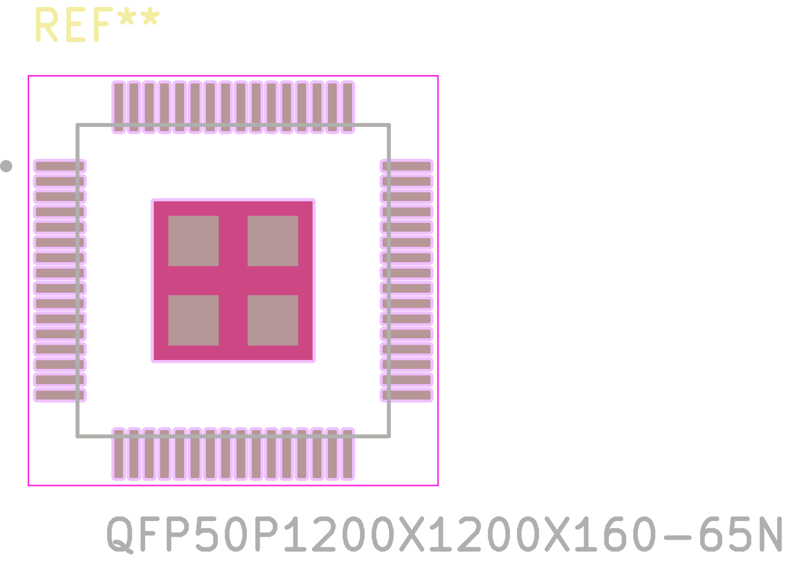

**Total time spent: 0.5 hours**

# October 8: Wider board and power cleanup

## What I did:

- Widened the board from 50 x 75 mm to 100 x 75 mm.
- Cleaned up power sheet values and properties.
- Reached 263 tracks and 160 vias.

## Why:

- The first outline was too tight for the connectors and the FPGA section.
- The power sheet still had values from the first pass and needed to match the BOM.
- Settling the final board size first kept the placement from changing later.

## Screenshots:

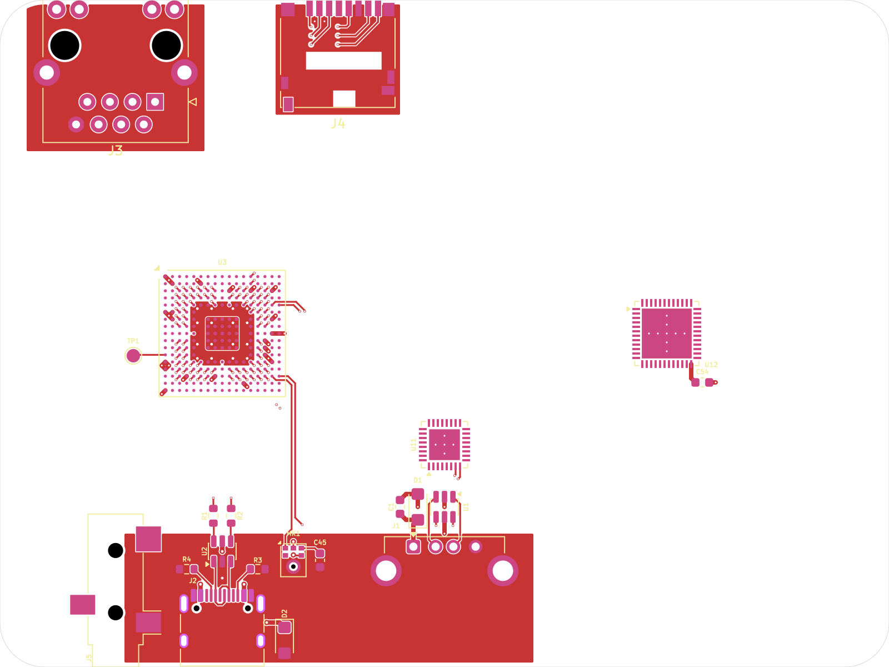

**Total time spent: 1 hour**

# October 9: Decoupling banks and test points

## What I did:

- Added 0.1 uF decoupling banks for the MCU, FPGA, and Ethernet PHY.
- Added test points TP3 to TP7 on the clock sheet.
- Placed 23 new parts and routed up to 577 tracks and 180 vias.

## Why:

- The H743 and iCE40 have many supply pins, so each bank needs its own local caps.
- The clock outputs are hard to probe once the board is assembled, so I added test points.
- Placing the decoupling first kept the caps near the pins.

## Screenshots:

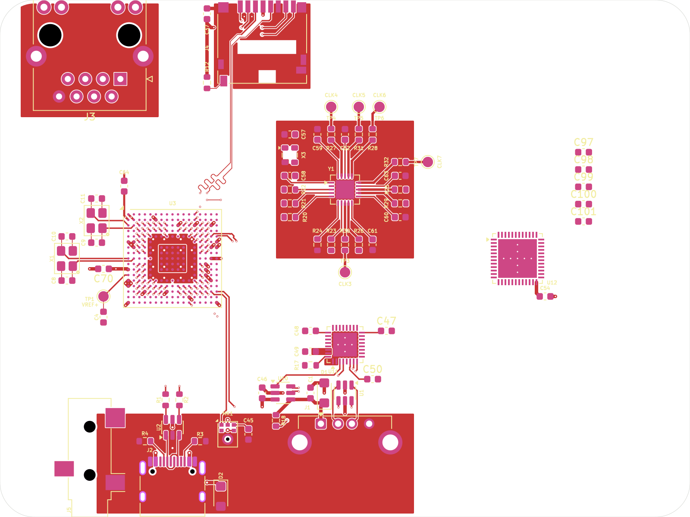

**Total time spent: 2 hours**

# October 10: MCU fanout

## What I did:

- Routed 143 more tracks and 43 vias.
- Ended the session at 720 tracks and 223 vias.

## Why:

- The MCU fanout is the densest area, so I worked on it in one pass.
- Tried to keep the tracks short and avoid unnecessary vias.

## Screenshots:

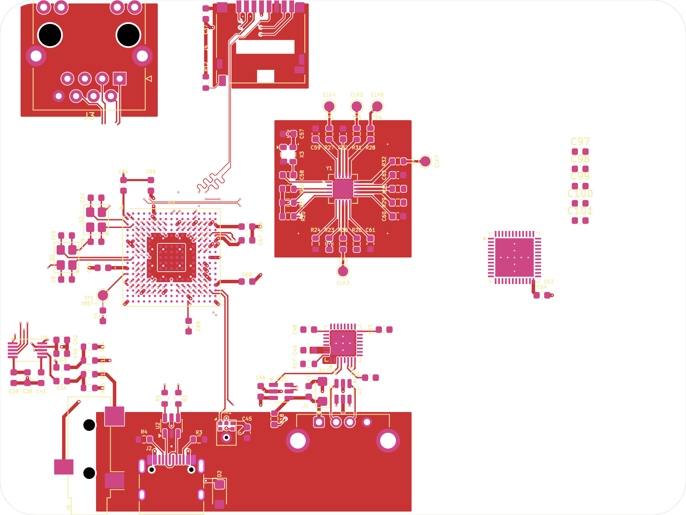

**Total time spent: 0.5 hours**

# October 11: Small decoupling fix

## What I did:

- Added one more 0.1 uF cap on the MCU sheet.
- Routed 18 more tracks and 8 vias.

## Why:

- I added one more 0.1 uF cap on the MCU sheet while checking the supply pins.
- I kept the change to one cap because the placement was already tight.

## Screenshots:

**Total time spent: 0.5 hours**

# October 13: FPGA and header routing

## What I did:

- Routed 120 more tracks and 43 vias.
- Worked on the FPGA and header area and the clock fanout.
- Ended the session at 858 tracks and 274 vias.

## Why:

- The FPGA header is the main expansion point, so those nets needed routes before the board got crowded.
- The clock outputs go to several sheets and were still unrouted.

## Screenshots:

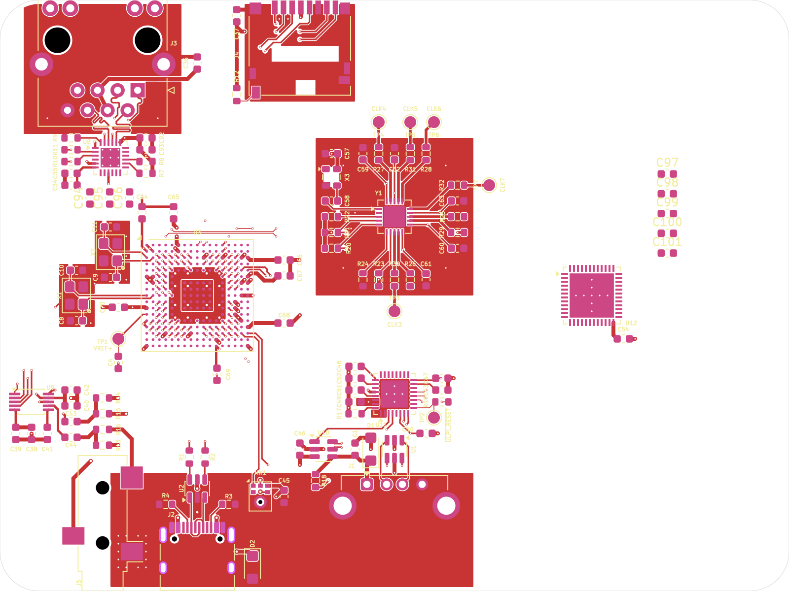

**Total time spent: 1 hour**

# October 14: Power routing

## What I did:

- Added 268 tracks and 59 vias.
- Focused on the power distribution and the remaining decoupling.
- Ended the session at 1126 tracks and 333 vias.

## Why:

- I had only partly connected the four rails, and I could not check the board without them.
- I needed to finish power routing before cleaning up the signal layers.

## Screenshots:

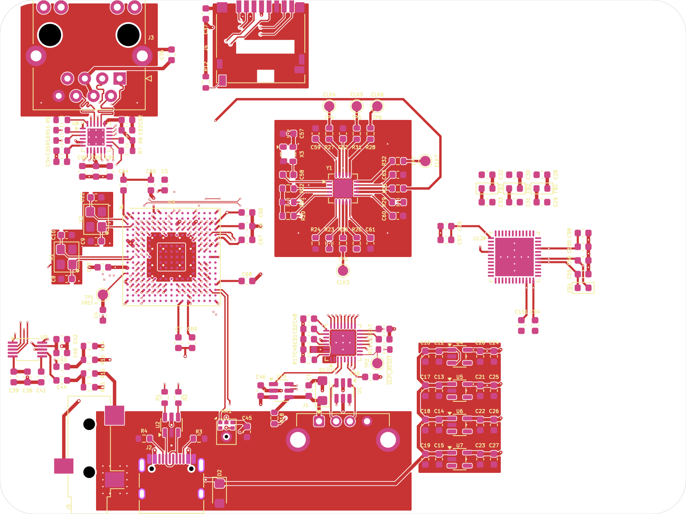

**Total time spent: 2.5 hours**

# October 15: Mounting holes, LEDs, and a second mic

## What I did:

- Added the two M3 mounting holes, the status LEDs with resistor networks, and the second PDM mic.
- Placed 14 new parts and routed 189 more tracks and 37 vias.

## Why:

- The board needs mounting holes before the outline is final.
- The LEDs give a visual state for the MCU and FPGA without a console.
- The second mic lets me test a stereo PDM setup later.

## Screenshots:

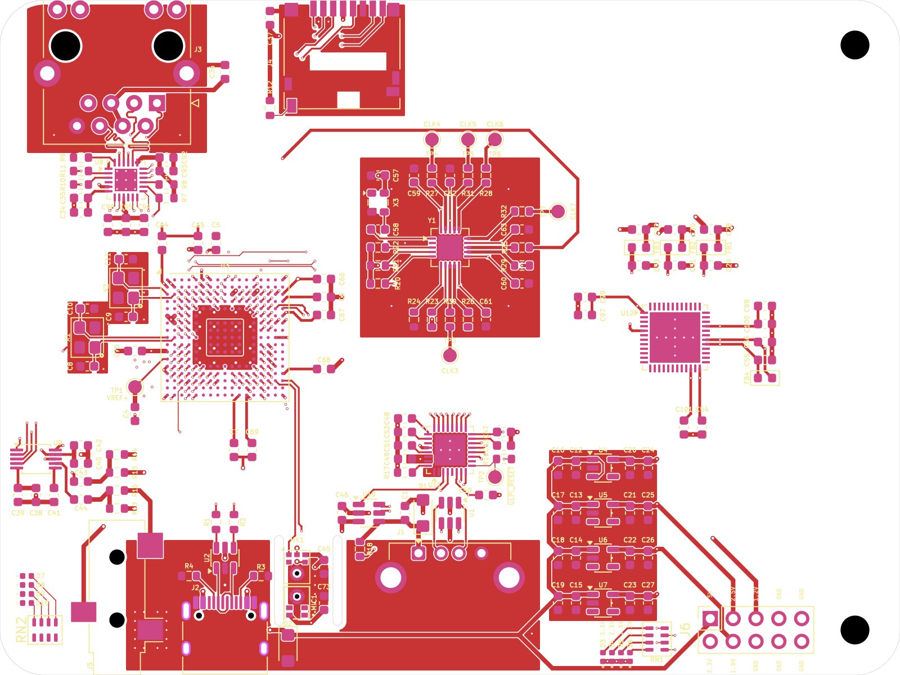

**Total time spent: 4.5 hours**

# October 16: Reset and user buttons

## What I did:

- Added SW1 and SW2 push buttons to the MCU sheet.
- Placed both buttons and adjusted the routing around them.

## Why:

- The board needs a hardware reset and a user button for bring-up.
- I placed the buttons at the board edge so I can reach them.

## Screenshots:

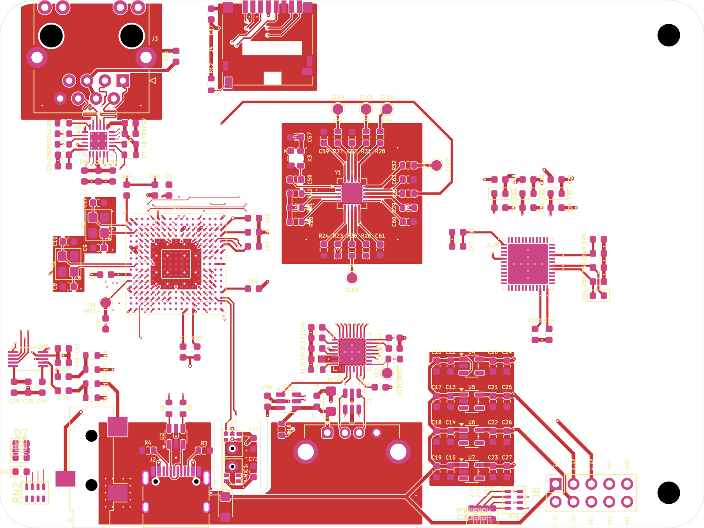

**Total time spent: 0.5 hours**

# October 17: ULPI cleanup and another header

## What I did:

- Added the 2x5 connector J6.
- Added ULPI decoupling, a ULPI test point, and a 0 ohm resistor network on the FPGA sheet.
- Routed 202 more tracks and 33 vias.

## Why:

- J6 adds another small header for spare I/O.
- The ULPI PHY needs its own local caps and a probe point.
- The 0 ohm network lets me isolate FPGA pins during bring-up.

## Screenshots:

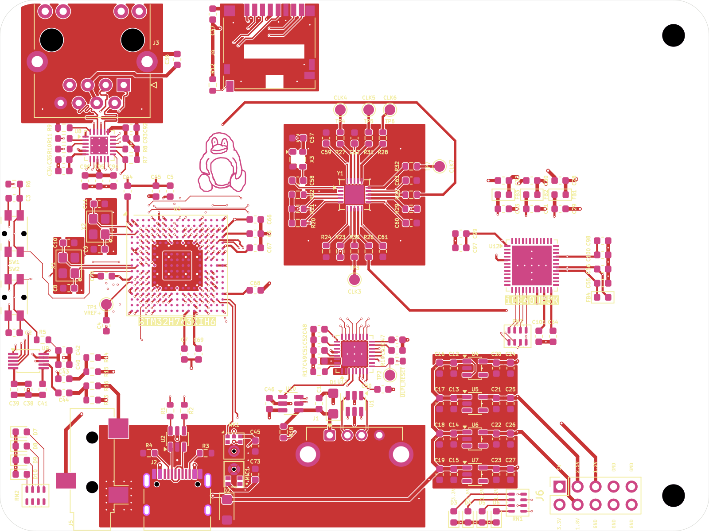

**Total time spent: 4 hours**

# October 18: GPIO header and FPGA LED

## What I did:

- Added the 2x22 GPIO header J7 and a 4-pin ABGR LED on the FPGA sheet.
- Routed 74 more tracks and 27 vias.

## Why:

- The GPIO header exposes the H743 peripherals for breadboarding.
- The RGB LED gives the FPGA a status output that does not use the debug header.
- One user-visible FPGA output was enough for the first layout.

## Screenshots:

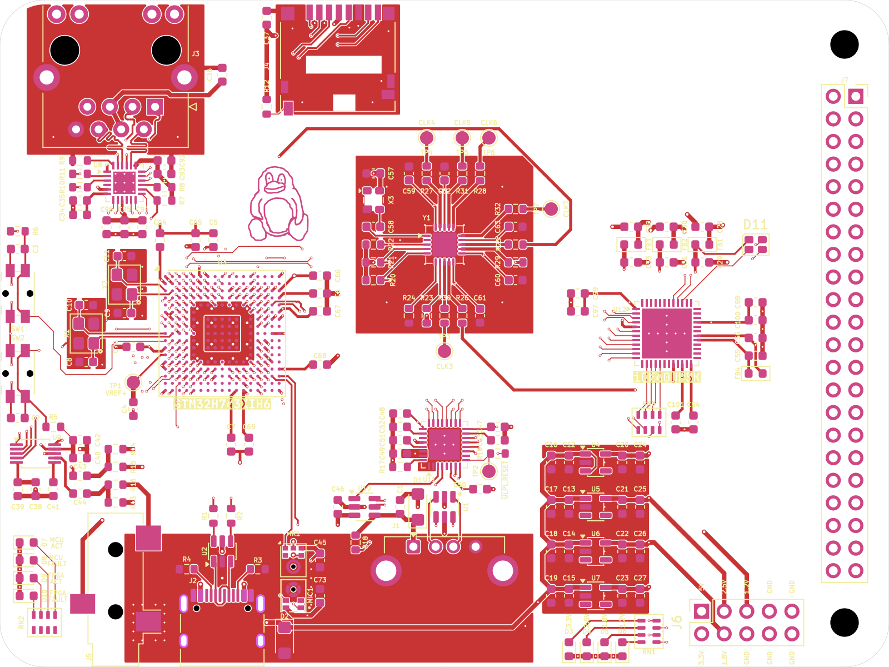

**Total time spent: 2 hours**

# October 20: Short connections

## What I did:

- Added 33 tracks and 27 vias.
- Cleared the remaining short connections around the MCU and power section.

## Why:

- I cleared the short connections first so the next long pass would not run into them.
- A cleaner starting point made the next routing pass easier.

## Screenshots:

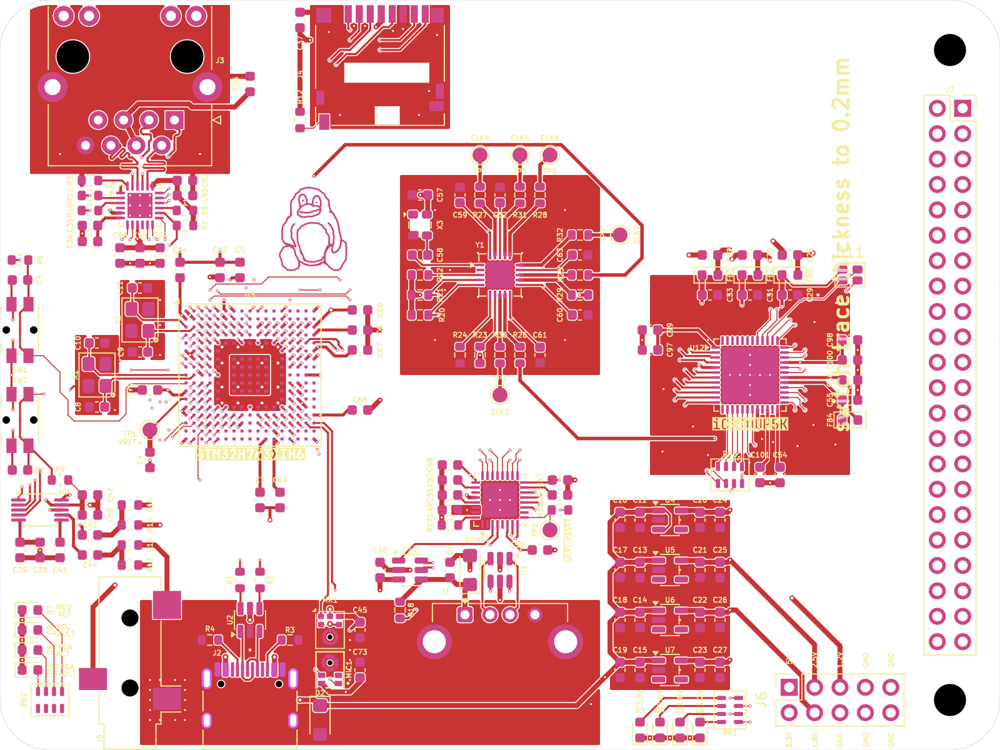

**Total time spent: 0.5 hours**

# October 21: Second GPIO header

## What I did:

- Added the 2x10 GPIO header J8 and placed it.
- Routed 186 more tracks and 71 vias.

## Why:

- A second header keeps the MCU and FPGA signals from crowding one connector.
- Placing J8 first let me route its nets in the same session.

## Screenshots:

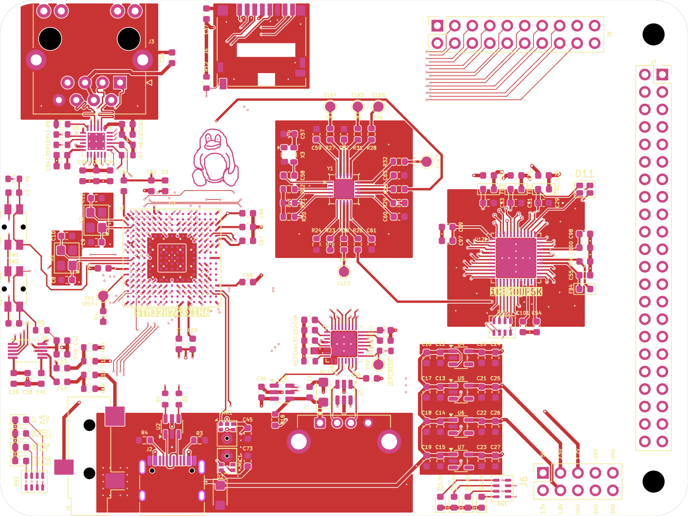

**Total time spent: 1.5 hours**

# October 22: Last signal groups

## What I did:

- Added 71 tracks and 23 vias.
- Worked through the remaining signal groups between the MCU, FPGA, and headers.

## Why:

- These were the last big groups without routes.
- Routing these groups showed how much room was left before cleanup.

## Screenshots:

**Total time spent: 0.5 hours**

# October 23: Final connector and full routing pass

## What I did:

- Added the 2x5 connector J9 and updated the connector sheet.
- Routed 388 more tracks and 21 vias, ending at 2266 tracks and 572 vias.

## Why:

- J9 adds one more small header for spare I/O.
- Most of the long routes were done, so this pass was about closing the remaining gaps.
- The connector pinout changed, so I updated the sheet and the board together.

## Screenshots:

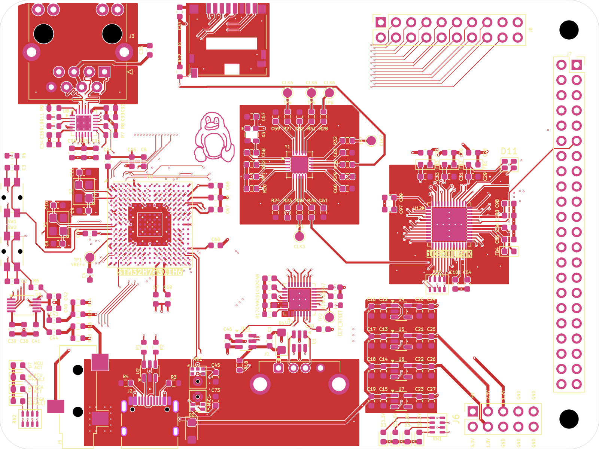

**Total time spent: 4 hours**

# October 24: Cleanup before review

## What I did:

- Removed redundant tracks and vias. The track count dropped from 2266 to 2257 and vias from 572 to 505.
- Cleaned up the connector and FPGA sheets.
- Went through the board once more before the submission review.

## Why:

- The fast routing passes left extra vias and a few redundant tracks.
- I wanted the board to be readable before the review.
- A cleaner board is easier for someone else to check.

## Screenshots:

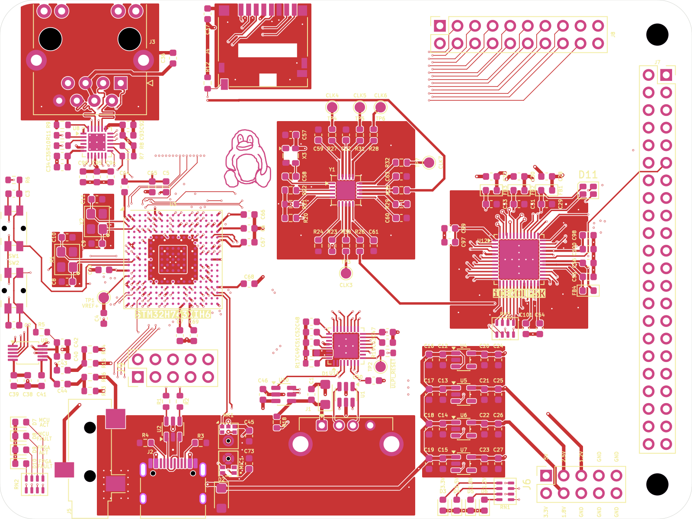

**Total time spent: 2.5 hours**

# October 25: PCB into Blender

## What I did:

- Exported the board with PCB2Blender. The archive has the board outline, one WRL for each footprint, the copper, mask, paste, and silkscreen layers, and the pad data.
- Imported the board and the component meshes into Blender.
- Checked the board size against the 100 x 75 mm outline and set up the scene collection and camera.
- Built a PCB material with separate solder mask, copper, silkscreen, board edge, and surface finish inputs.
- Added a three-point light rig and a camera.
- Rendered a 1920x1080 frame in Cycles and saved the scene

## Why:

- The KiCad 3D viewer is fine for checking part placement, but I wanted a better image of the finished board.
- Keeping the copper and silkscreen layers separate lets me use the real board artwork in the material instead of faking it.
- The board has a lot of small parts, including the TFBGA-265 and the 2x22 headers, so I checked the import before adding materials.
- A flat green board material hides the silkscreen and the small parts.
- I wanted the render to show the actual copper and silkscreen artwork from the board files.
- The render is for the project page, so I wanted it to look like the assembled board.

## Screenshots:

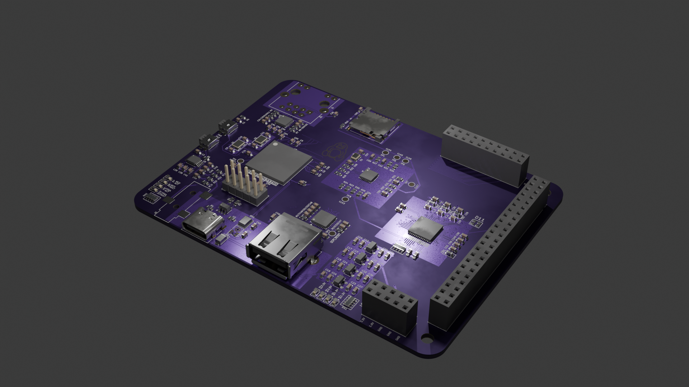

**Total time spent: 2 hours**

# October 25: Submission review and BOM

## What I did:

- Exported the PCB renders, copper composite, and all 14 schematic pages.
- Built a priced BOM with LCSC and Mouser links for every part.
- Went through the design against the Forge submission checklist.
- Found four design problems: the LTDC sheet is still a placeholder, X2 uses a 3225 4-pad footprint for a 32.768 kHz crystal, C1 was 120 uF in an 0603 footprint, and the exact iCE40 part is obsolete.
- Wrote the README and listed the open issues.

## Why:

- The KiCad files existed but there was no README, BOM, license, or journal for someone else to review.
- I want the review to be about the real board, not a cleaned-up version that ignores the parts that do not work yet.
- The X2 and C1 problems have to be fixed in a rev B before the board can be assembled as drawn.

## Screenshots:

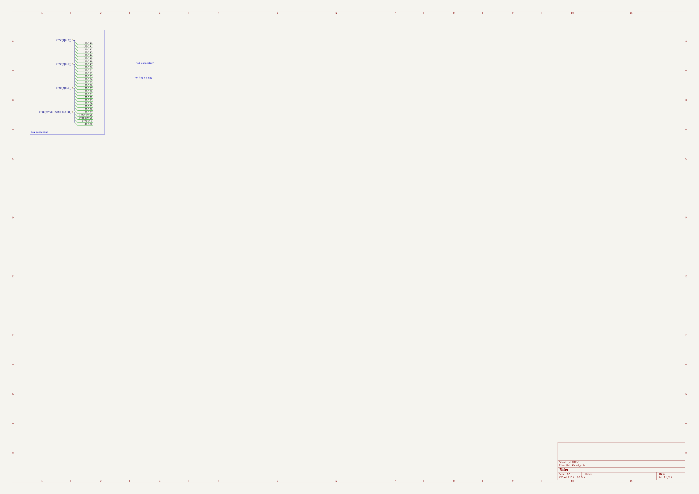

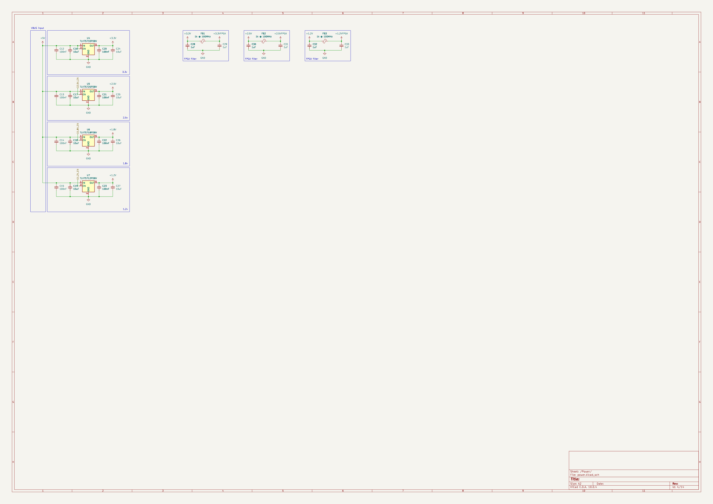

**Total time spent: 2 hours**

# October 26: Firmware skeleton and PlatformIO

## What I did:

- Added the firmware sources for the clock tree, console, Si5351, FPGA load, SD card, audio, Ethernet PHY, and ULPI.
- Added the PlatformIO project, the custom STM32H743XIH6 board file, the FPGA top level and bitstream, and the scripts that embed the bitstream.
- Removed the old Makefile and the unused fpgaperipherals and sensors sheets.
- Built the firmware. It has not run on hardware yet.

## Why:

- The board needs a boot test that reports each peripheral over semihosting before I trust the hardware.
- PlatformIO makes the build repeatable and keeps the vendor HAL out of the application code.
- The unused sheets were not in the hierarchy and only made the project harder to follow.
- I want to be clear that the board is still untested.

## Screenshots:

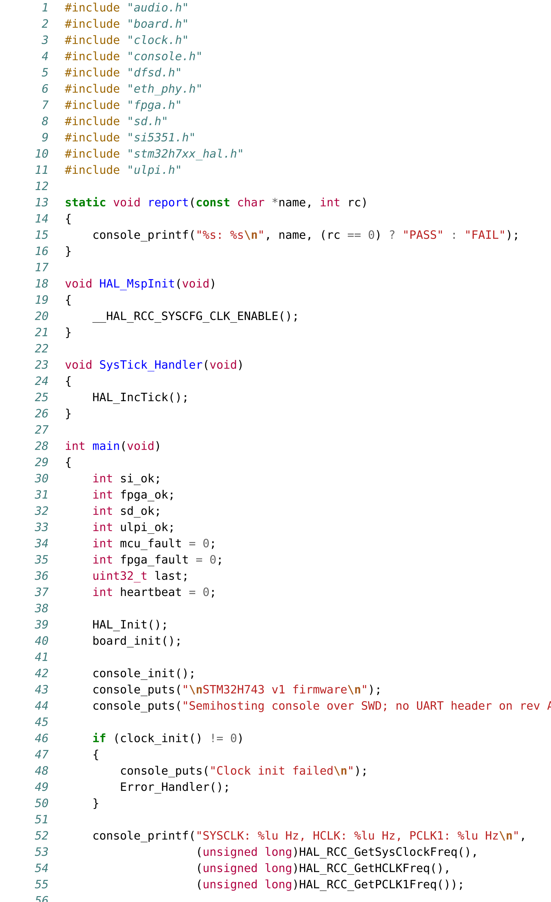

**Total time spent: 1 hour**

# October 26: Blender render and silkscreen

## What I did:

- Fixed large silkscreens on PCB, so that all the silkscreen size is uniform
- Added silkscreen labels to unlabeled headers
- Added better lighting in blender to show the details of the headers more

## Why:

- The blender render is the fancy part of the project
- Unlabeled headers are a recurring nightmare
- Silkscreen text size mismatch looks funny

## Screenshots:

