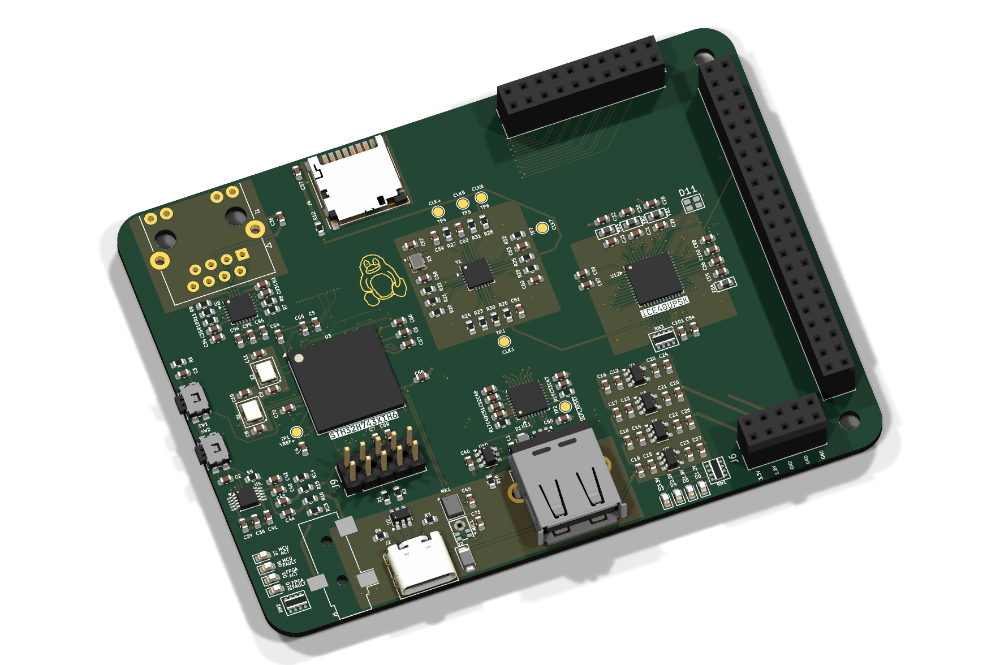
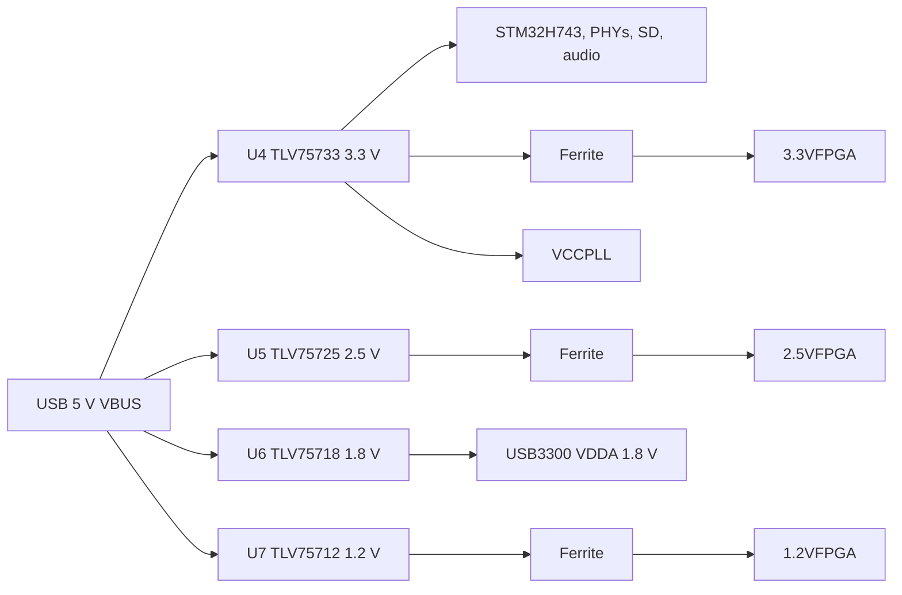
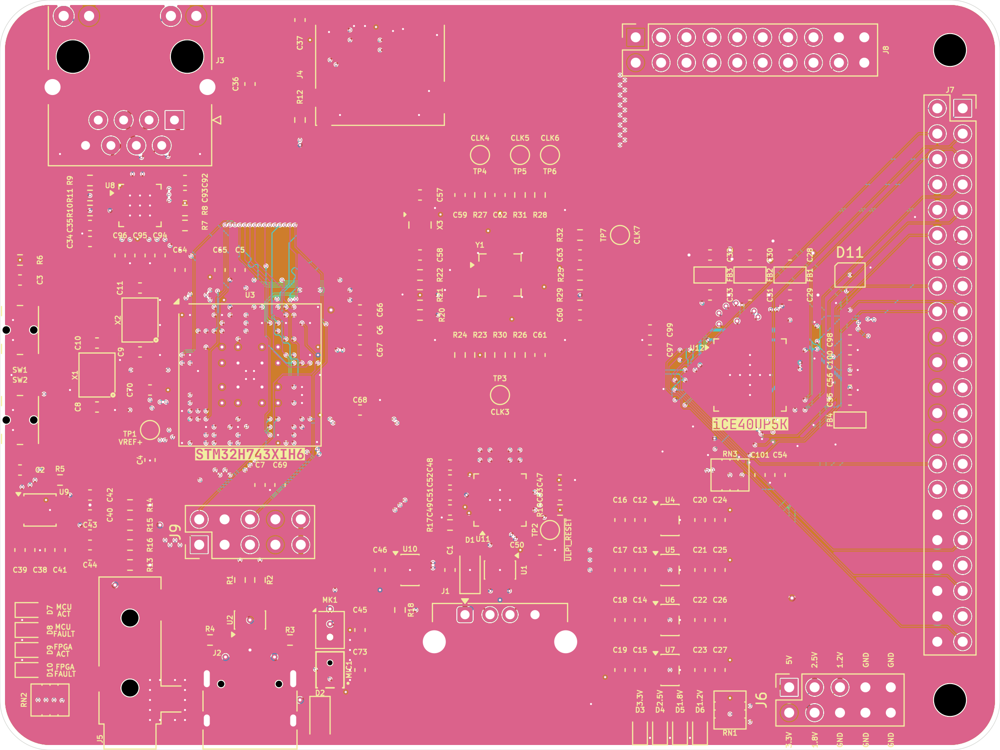
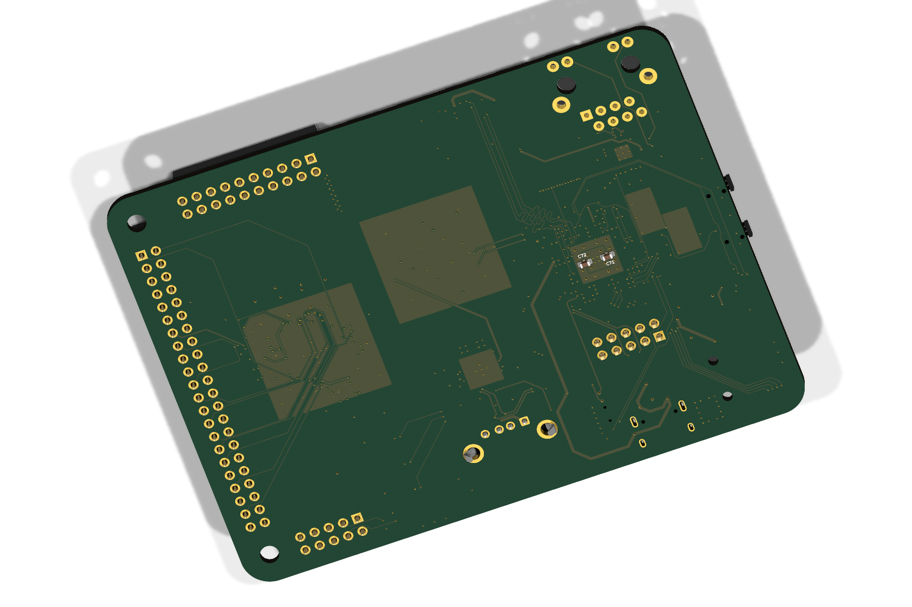
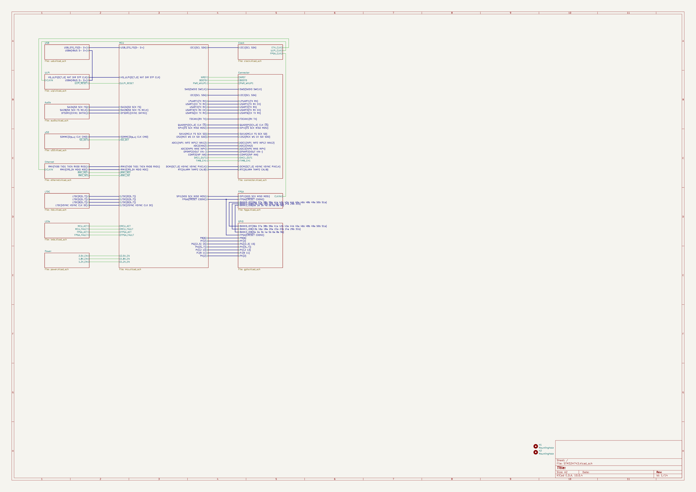

# STM32H743 FPGA Devboard

> A STM32H743 board with an iCE40 UP5K FPGA, USB High-Speed PHY, Ethernet, and audio I/O.

This board puts an STM32H743XIH6 and an iCE40 UP5K on the same PCB.
The H743 handles control, USB, Ethernet, storage, and audio.
The UP5K provides small programmable logic for custom interfaces and filters, and also an easy way to goof off with the FPGA.
The design is aimed at audio DSP and FPGA experiments that would otherwise need several dev boards.



## Project Status

The board has not been fabricated, assembled, or brought up yet.
Bare-metal firmware is included and builds cleanly, but it has not been run on hardware.
An enclosure and a full mechanical assembly are not included in this revision.

## Custom Features

- STM32H743XIH6, with 2 MB flash and external memory buses exposed on headers.
- iCE40 UP5K FPGA connected to the MCU and to two 2.54 mm headers for logic experiments.
- USB3300 ULPI PHY for USB 2.0 High-Speed, with ESD protection.
- LAN8742A 10/100 Ethernet PHY and an RJ45 jack with integrated magnetics.
- Si5351C clock generator with a 25 MHz TCXO and a 25 MHz crystal. A 32.768 kHz crystal feeds the RTC/LSE on the STM32.
- CS4344 stereo I2S DAC, a 3.5 mm output jack, and two microphones (ICS-43434 and MMICT390200012).
- MicroSD socket on a 4-bit SDMMC bus.
- USB-C sink port for power and USB-A host port with a 500mA power switch.
- Four LDO rails (3.3 V, 2.5 V, 1.8 V, 1.2 V) with ferrite-filtered FPGA supplies.

## How It Works

| Block | Part | Role |
|-------|------|------|
| MCU | STM32H743XIH6 | Main controller, USB, Ethernet MAC, SDMMC, audio, control |
| FPGA | ICE40UP5K-SG48I | Programmable logic and custom interfaces |
| USB PHY | USB3300-EZK | ULPI PHY for USB 2.0 High-Speed |
| Ethernet PHY | LAN8742A | RMII 10/100 PHY |
| Clock | Si5351C-B-GM | Eight-output clock generator |
| Audio DAC | CS4344 | Stereo I2S DAC to the 3.5 mm jack |
| Microphones | ICS-43434, MMICT390200012 | PDM digital microphones |
| Storage | Hirose DM3D-SF | microSD card socket on SDMMC |
| USB power | TPD3S014 | Current-limited USB-A host port switch |
| Power | TLV75733, TLV75725, TLV75718, TLV75712 | 3.3 V, 2.5 V, 1.8 V, and 1.2 V LDO rails |

### Power Tree



The FPGA core, PLL, and I/O rails are separated from the main rails with 1 kohm at 100 MHz ferrites and local decoupling. Each LDO has its own input and output capacitors. The 3.3 V rail also supplies the MCU, Ethernet PHY, audio DAC, microphones, and microSD socket.

## PCB Design

The PCB is 100 x 75.00 mm, 1.6 mm thick, and uses six copper layers. It has two M3 mounting holes. The board has 173 footprints, 966 pads, 2257 track segments, 505 vias, and 6 copper zones.



The 6-layer stackup uses 0.1 mm and 0.535 mm dielectrics with 0.035 mm copper. The FPGA and MCU decoupling is placed on the same side as the pins, and the USB, Ethernet, and SD routes are kept short. Power and ground are distributed on the inner layers.




## Firmware

Bare-metal C firmware is in [firmware](firmware) and is licensed under MIT. It is a self-test and bring-up image, not a full USB, Ethernet, or audio application. It has not been verified on hardware because no board has been assembled yet.

The project uses PlatformIO. Build it with:

```sh
cd firmware
pio run
```

The output is `.pio/build/stm32h743xih6/firmware.elf` and `firmware.bin`. The project pins `ststm32@19.7.0` and uses the custom board definition in `firmware/boards/stm32h743xih6.json`. PlatformIO builds against its `framework-stm32cubeh7` package rather than the vendored `firmware/Drivers` tree, which is kept as reference. The first build may download the platform, framework, and GCC 7.2.1 toolchain.

The checked-in `firmware/src/fpga_bitstream.c` means the FPGA toolchain is only needed when rebuilding the bitstream:

```sh
make -C firmware/fpga
python3 firmware/tools/embed_bitstream.py
```

The firmware uses ARM semihosting over SWD for its console. There is no UART header on rev A, so output only appears while a debugger is attached and the debug enable bit is set. Program the board over SWD with an ST-Link (the default `upload_protocol`) or a J-Link after changing `upload_protocol` and `debug_tool`; there is no USB bootloader or DFU path.

```sh
pio run -t upload   # first upload downloads PlatformIO's OpenOCD package
pio debug           # starts GDB and enables semihosting
```

At boot the firmware configures the 400 MHz clock tree and the three switched LDO rail enables (3.3 V is always on), then runs these checks:

1. Si5351C over I2C and all eight clock outputs.
2. iCE40 bitstream load over SPI1, with CDONE/CRESET handshaking.
3. SDMMC1 card init, CID/CSD read, and a 4-bit bus attempt. The PD4 card-detect pin is not used by the firmware.
4. A short 1 kHz stereo tone through the CS4344 DAC.
5. A LAN8742A MDIO probe and a USB3300 ULPI register probe.
6. A 1 Hz heartbeat on `MCU_ACT`, with `FPGA_ACT` toggling alongside it.

`MCU_FAULT` and `FPGA_FAULT` latch if the Si5351 or FPGA load fails. A missing SD card, PHY, or ULPI device is reported but does not latch a fault. The MIC path is deliberately skipped; see Known Issues.

## Usage

Power the board from the USB-C port. The USB-A port is a host port and is protected by a TPD3S014 load switch and USBLC6 ESD diodes. The USB3300 ULPI PHY is probed in firmware, but no USB device or host stack is implemented.

- Program and debug over SWD.
- Connect Ethernet to the RJ45 jack. The PHY can be probed over MDIO, but the H743 RMII reference clock is not wired, so the Ethernet MAC is not usable in rev A.
- Insert a microSD card in J4. The card uses the 4-bit SDMMC bus.
- Audio output is on J5, the 3.5 mm jack. The two microphones are on the board, but the firmware does not capture from them.
- Some features were left unconnected due to lack of board space

| Interface | Signals on the headers |
|-----------|------------------------|
| FPGA | BANK0_IOT, BANK1_IOB, BANK2_IOB, CDONE, CRESET |
| MCU GPIO | PB, PF, PG, PH, PI, PJ, PK pins |
| Analog | ADC1, ADC2, ADC3, COMP2, OPAMP2 |
| Camera | DCMI D0-D7, HSYNC, VSYNC, PIXCLK |
| Serial | USART1, USART2, USART3, USART6, LPUART1 |
| Other | FDCAN1, I2C2, I2S2, QUADSPI, RTC, SAI1A, SPI4, SWD |

See [kicad/gpio.kicad_sch](kicad/gpio.kicad_sch) for J7 and J8, and [kicad/connector.kicad_sch](kicad/connector.kicad_sch) for J6 and J9. The schematic PDFs and PNG exports are in [images/schematic](images/schematic).



## BOM (Bill of Materials)

Prices were checked on 2026-10-25 at quantity 1. The PCB and shipping lines are estimates. Assembly fees, stencils, taxes, and import charges are not included.

| Item | Cost |
|------|------|
| PCB (qty 5, 6-layer, estimate) | $57.00 |
| Components (one board) | $67.12 |
| Shipping (estimate) | $18.00 |
| **Total** | **$142.12** |

See [BOM.csv](BOM.csv) for the full part list with supplier links and a total cost line.

## Production

The fabrication files are in [kicad/production/STM32H743.zip](kicad/production/STM32H743.zip). The folder contains Gerbers, plated and non-plated drill files, board outline, paste, silkscreen, and solder mask layers. The KiCad source files are in [kicad](kicad).

The board is a 6-layer, 1.6 mm design. For fabrication, use the cheapest standard finish and global standard direct-line shipping.

## Repository Structure

```text
STM32H743/
|-- kicad/                 # KiCad project and 13 hierarchical sheets
|   |-- production/        # Gerbers, drill files, BOM, positions
|   |-- STM32H743.kicad_pro
|   |-- STM32H743.kicad_sch
|   `-- STM32H743.kicad_pcb
|-- cad/
|   `-- STM32H743.step     # STEP export of the PCB assembly
|-- firmware/
|   |-- src/               # Bare-metal C sources and embedded bitstream
|   |-- inc/               # Board, clock, and peripheral headers
|   |-- fpga/              # iCE40 Verilog, constraints, and bitstream Makefile
|   |-- boards/            # PlatformIO custom STM32H743XIH6 board
|   |-- tools/             # Bitstream embedding and PlatformIO helper scripts
|   |-- Drivers/           # Vendored STM32Cube HAL/CMSIS reference tree
|   `-- platformio.ini     # PlatformIO build and upload configuration
|-- blender/
|   `-- STM32H743XIH6.blend
|-- images/
|   |-- render-top.png
|   |-- render-bottom.png
|   |-- pcb.png
|   |-- schematic/         # 14 schematic pages
|   |-- schematic-svg/     # SVG source for the schematic pages
|   `-- screenshots/       # Timestamped progress screenshots
|-- parts/                 # Extra symbols and footprints
|-- BOM.csv
|-- JOURNAL.md
|-- LICENSE                # CERN-OHL-P-2.0 for hardware
|-- LICENSE-MIT            # MIT for firmware
`-- README.md
```

## Known Issues

These are the open items before this board can be treated as a finished product.

1. The LTDC sheet is a placeholder. It has bus labels and notes but no display connector, so the LTDC peripheral is not physically brought out.
2. X2 is a 32.768 kHz LSE crystal on a 3225 4-pad footprint. Common 32.768 kHz crystals are 3215 2-pad. Rev B must change the footprint to 3215 2-pad or use a 4-pad part from a non-LCSC source.
3. C1 is specified as 120 uF in an 0603 footprint, which cannot be assembled. The BOM lists a 47 uF 0603 part instead. This is below the USB 2.0 host recommendation of 120 uF.
4. The ICE40UP5K-SG48ITR is obsolete. The BOM uses the ICE40UP5K-SG48I, which has the same package and an industrial temperature range.
5. Firmware is included but has never run on hardware because no board has been fabricated. Its clock, Si5351, FPGA, SD, audio, Ethernet, and ULPI paths are unverified.
6. Ethernet is not usable in rev A. The LAN8742A is wired for RMII, but the 50 MHz REF_CLK is not connected to the H743 `PA1` pin, which is used for the PHY interrupt instead. The firmware only probes the PHY over MDIO. (Should be fixed as RMII_INT and RMII_REFCLKO share the same pin)
7. No USB stack is included. The USB3300 ULPI PHY is only probed at the register level.
8. The two PDM microphones are not supported by the firmware. MIC1 is wired to `DFSDM1_CKIN1`/`DATIN1`, but its PDM clock is not driven by a clock output, and the SAI2A path to the other microphone would need software PDM decimation.
9. There is no enclosure, no native CAD source, and no mechanical assembly with screws or clips. Only a STEP export of the PCB exists.
10. The design has not been sanity-checked by another person yet.
11. `kicad/fpgaperipherals.kicad_sch` contains three parts that are not on the PCB, and `kicad/sensors.kicad_sch` is empty. Neither sheet is in the hierarchy.
12. The root schematic title block is empty. Add the project title, revision, and author before release.

## Credits and Inspiration

- KiCad symbol, footprint, and 3D model libraries.
- The Hack Club Forge submission checklist and README structure.
- USB3300, LAN8742A, and CS4344 reference schematics from their datasheets.

## License

Hardware design files (schematics, PCB layout, CAD, and images) are licensed under CERN-OHL-P-2.0. See [LICENSE](LICENSE).

SPDX-License-Identifier: CERN-OHL-P-2.0

Firmware is licensed under the MIT License. See [LICENSE-MIT](LICENSE-MIT).

SPDX-License-Identifier: MIT
