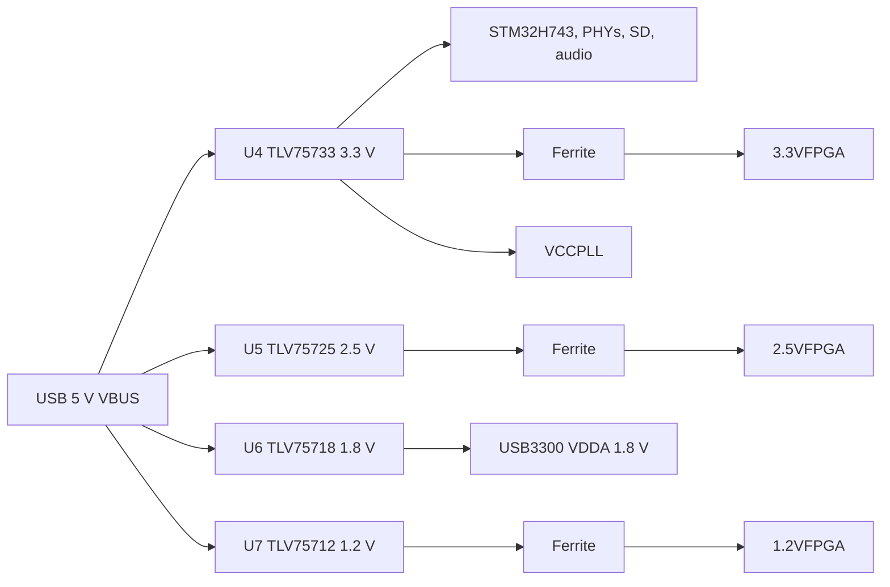

# STM32H743 FPGA Devboard

> A 6-layer STM32H743 board with an iCE40 UP5K FPGA, USB High-Speed PHY, Ethernet, and audio I/O.

This board puts an STM32H743XIH6 and an iCE40 UP5K on the same PCB. The H743 handles control, USB, Ethernet, storage, and audio. The UP5K provides small programmable logic for custom interfaces and filters. The design is aimed at audio DSP and FPGA experiments that would otherwise need several dev boards.


## Project Status

Rev A is designed in KiCad 10.0.4 and the gerbers are generated. The board has not been fabricated, assembled, or brought up yet. Firmware, an enclosure, and a full mechanical assembly are not included in this revision. See Known Issues before ordering boards.

## Custom Features

- STM32H743XIH6 in TFBGA-265, with 2 MB flash and external memory buses exposed on headers.
- iCE40 UP5K-SG48 FPGA connected to the MCU and to two 2.54 mm headers for logic experiments.
- USB3300 ULPI PHY for USB 2.0 High-Speed, with USBLC6 ESD protection.
- LAN8742A 10/100 Ethernet PHY and an RJ45 jack with integrated magnetics.
- Si5351C clock generator with a 25 MHz TCXO and a 25 MHz crystal. A 32.768 kHz crystal feeds the RTC/LSE.
- CS4344 stereo I2S DAC, a 3.5 mm output jack, and two PDM microphones (ICS-43434 and MMICT390200012).
- MicroSD socket on a 4-bit SDMMC bus.
- USB-C sink port for power and USB-A host port with a TPD3S014 power switch.
- Four LDO rails (3.3 V, 2.5 V, 1.8 V, 1.2 V) with ferrite-filtered FPGA supplies.

## How It Works

| Block | Part | Role |
|-------|------|------|
| MCU | STM32H743XIH6 | Main controller, USB, Ethernet MAC, SDMMC, audio, control |
| FPGA | ICE40UP5K-SG48I | Programmable logic and custom interfaces |
| USB PHY | USB3300-EZK | ULPI PHY for USB 2.0 High-Speed |
| Ethernet PHY | LAN8742A | RMII 10/100 PHY |
| Clock | Si5351C-B-GM | Three-output clock generator |
| Audio DAC | CS4344 | Stereo I2S DAC to the 3.5 mm jack |
| Microphones | ICS-43434, MMICT390200012 | PDM digital microphones |
| Storage | Hirose DM3D-SF | microSD card socket on SDMMC |
| USB power | TPD3S014 | Current-limited USB-A host port switch |
| Power | TLV75733, TLV75725, TLV75718, TLV75712 | 3.3 V, 2.5 V, 1.8 V, and 1.2 V LDO rails |

### Power Tree



The FPGA core, PLL, and I/O rails are separated from the main rails with 1 kohm at 100 MHz ferrites and local decoupling. Each LDO has its own input and output capacitors. The 3.3 V rail also supplies the MCU, Ethernet PHY, audio DAC, microphones, and microSD socket.

## PCB Design

The PCB is 104.27 x 81.00 mm, 1.6 mm thick, and uses six copper layers. It has two M3 mounting holes at (125, 35) and (125, 100) mm. All routing was done by hand; no autorouter was used. The board has 173 footprints, 966 pads, 2257 track segments, 505 vias, and 6 copper zones.


The 6-layer stackup uses 0.1 mm and 0.535 mm dielectrics with 0.035 mm copper. The FPGA and MCU decoupling is placed on the same side as the pins, and the USB, Ethernet, and SD routes are kept short. Power and ground are distributed on the inner layers.


## Firmware

No firmware is included in this revision. The repository is hardware-only at the moment. The bring-up plan is:

1. Verify all four LDO rails and the FPGA core voltage before first MCU power-up.
2. Bring up the STM32H743 clock tree and SWD connection.
3. Load a minimal iCE40 bitstream and check CDONE and CRESET.
4. Test USB3300 ULPI enumeration, Ethernet RMII, microSD, and the audio DAC.
5. Test the Si5351C over I2C and measure the clock outputs.

Firmware will use the MIT license when it is added.

## Usage

Power the board from the USB-C port. The USB-C port is a sink and has 5.1 k CC pulldowns. The USB-A port is a host port and is protected by a TPD3S014 load switch and USBLC6 ESD diodes.

- Program and debug over SWD. The SWD signals are brought out on the 2x5 connector sheet.
- Connect Ethernet to J3, the RJ45 jack with integrated magnetics.
- Insert a microSD card in J4. The card uses the 4-bit SDMMC bus.
- Audio output is on J5, the 3.5 mm jack. The two PDM microphones are on the board.
- J7 is a 2x22 socket, J8 is a 2x10 socket, and J6 and J9 are 2x5 connectors. They break out FPGA I/O banks, MCU GPIO, ADC, DCMI, FDCAN, I2C2, I2S2, LPUART1, OPAMP2, QUADSPI, RTC, SAI1A, SPI4, SWD, USART1, USART2, USART3, and USART6.

| Interface | Signals on the headers |
|-----------|------------------------|
| FPGA | BANK0_IOT, BANK1_IOB, BANK2_IOB, CDONE, CRESET |
| MCU GPIO | PB, PF, PG, PH, PI, PJ, PK pins |
| Analog | ADC1, ADC2, ADC3, COMP2, OPAMP2 |
| Camera | DCMI D0-D7, HSYNC, VSYNC, PIXCLK |
| Serial | USART1, USART2, USART3, USART6, LPUART1 |
| Other | FDCAN1, I2C2, I2S2, QUADSPI, RTC, SAI1A, SPI4, SWD |

See [kicad/gpio.kicad_sch](kicad/gpio.kicad_sch) for J7 and J8, and [kicad/connector.kicad_sch](kicad/connector.kicad_sch) for J6 and J9. The schematic PDFs and PNG exports are in [images/schematic](images/schematic).


## BOM (Bill of Materials)

Prices were checked on 2026-10-25 at quantity 1. The PCB and shipping lines are estimates. Assembly fees, stencils, taxes, and import charges are not included.

| Item | Cost |
|------|------|
| PCB (qty 5, 6-layer, estimate) | $57.00 |
| Components (one board) | $67.12 |
| Shipping (estimate) | $18.00 |
| **Total** | **$142.12** |

See [BOM.csv](BOM.csv) for the full part list with supplier links and a total cost line.

## Production

The fabrication files are in [kicad/production/STM32H743.zip](kicad/production/STM32H743.zip). The folder contains Gerbers, plated and non-plated drill files, board outline, paste, silkscreen, and solder mask layers. The KiCad source files are in [kicad](kicad).

The board is a 6-layer, 1.6 mm design. For fabrication, use the cheapest standard finish and global standard direct-line shipping. Avoid express air couriers. The zip contains Gerbers and drill files only; the KiCad source files are in the repository, not inside the zip.

## Repository Structure

```text
STM32H743/
|-- kicad/                 # KiCad project and 13 hierarchical sheets
|   |-- production/        # Gerbers, drill files, BOM, positions
|   |-- STM32H743.kicad_pro
|   |-- STM32H743.kicad_sch
|   `-- STM32H743.kicad_pcb
|-- cad/
|   `-- STM32H743.step     # STEP export of the PCB assembly
|-- blender/
|   `-- STM32H743XIH6.blend
|-- images/
|   |-- render-top.png
|   |-- render-bottom.png
|   |-- pcb.png
|   |-- schematic/         # 14 schematic pages
|   |-- schematic-svg/     # SVG source for the schematic pages
|   `-- screenshots/       # Timestamped progress screenshots
|-- parts/                 # Extra symbols and footprints
|-- BOM.csv
|-- JOURNAL.md
|-- LICENSE                # CERN-OHL-P-2.0 for hardware
|-- LICENSE-MIT            # MIT for firmware
`-- README.md
```

## Known Issues

These are the open items before this board can be treated as a finished product.

1. The LTDC sheet is a placeholder. It has bus labels and notes but no display connector, so the LTDC peripheral is not physically brought out.
2. X2 is a 32.768 kHz LSE crystal on a 3225 4-pad footprint. Common 32.768 kHz crystals are 3215 2-pad. Rev B must change the footprint to 3215 2-pad or use a 4-pad part from a non-LCSC source.
3. C1 is specified as 120 uF in an 0603 footprint, which cannot be assembled. The BOM lists a 47 uF 0603 part instead. This is below the USB 2.0 host recommendation of 120 uF.
4. The ICE40UP5K-SG48ITR is obsolete. The BOM uses the ICE40UP5K-SG48I, which has the same package and an industrial temperature range.
5. There is no firmware.
6. There is no enclosure, no native CAD source, and no mechanical assembly with screws or clips. Only a STEP export of the PCB exists.
7. The design has not been sanity-checked by another person yet.
8. `kicad/fpgaperipherals.kicad_sch` contains three parts that are not on the PCB, and `kicad/sensors.kicad_sch` is empty. Neither sheet is in the hierarchy.
9. The root schematic title block is empty. Add the project title, revision, and author before release.

## Credits and Inspiration

- KiCad symbol, footprint, and 3D model libraries.
- The Hack Club Forge submission checklist and README structure.
- USB3300, LAN8742A, and CS4344 reference schematics from their datasheets.

## License

Hardware design files (schematics, PCB layout, CAD, and images) are licensed under CERN-OHL-P-2.0. See [LICENSE](LICENSE).

SPDX-License-Identifier: CERN-OHL-P-2.0

Firmware, when added, is licensed under the MIT License. See [LICENSE-MIT](LICENSE-MIT).

SPDX-License-Identifier: MIT
